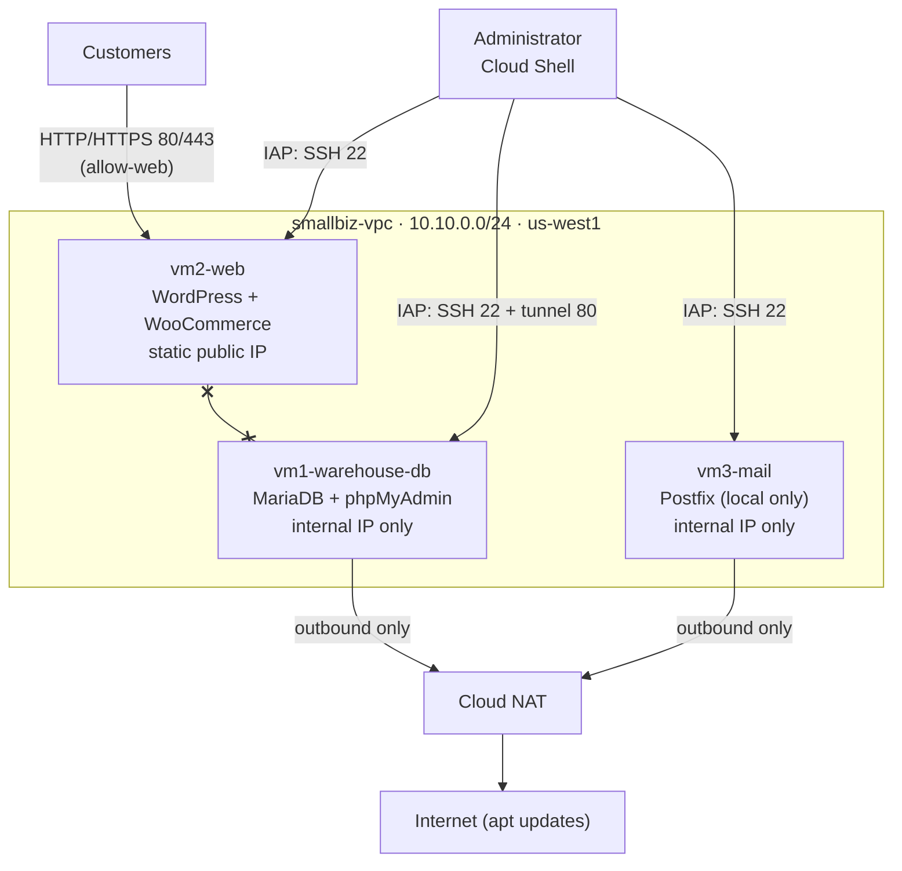

# Tallypoint Systems: Small Business Network on Google Cloud

A small business network built on Google Cloud for an IT infrastructure course: a warehouse inventory database, a public e-commerce store, and an internal email server, each on its own Ubuntu VM.

**Tallypoint Systems is a fictional company** created for the project: a 136-person maker of Windows point-of-sale software and hardware for independent retailers. Product names, prices and inventory figures are sample data.


## Architecture



| Server | Role | Stack | Exposure |
|---|---|---|---|
| `vm2-web` | Customer-facing e-commerce store | Apache, PHP 8.3, MariaDB, WordPress, WooCommerce, Storefront | Ports 80/443 public; SSH via IAP only |
| `vm1-warehouse-db` | Warehouse inventory system | MariaDB 10.11, Apache, phpMyAdmin, UFW | No public IP; portal via IAP tunnel only |
| `vm3-mail` | Internal email | Postfix (local only), mailutils | No public IP |

All servers run Ubuntu 24.04 LTS on e2-small machines. Firewall rules allow only what each role needs; deny rules at priority 900 block all traffic between the store and the warehouse.

## Repository layout

```
docs/
  task1-setup-guide.md               Network + three servers, with the reasoning for each choice
  task2-ecommerce-warehouse-guide.md Store and inventory system build guide
  task2-configuration-report.md      Configuration log with captioned screenshots
  images/                            Redacted screenshots
infrastructure/
  01-network.sh                      VPC, subnet, firewall rules, Cloud NAT
  02-create-vms.sh                   The three Ubuntu servers (no public IPs)
  03-task2-network.sh                Static IP, allow-web, store/warehouse deny rules
  stop-all.sh                        Stop every VM to save credit
web-server/
  store-setup/                       WP-CLI installer that builds the Tallypoint store
  config/                            Apache and PHP config used on vm2-web
warehouse-server/
  tallypoint-warehouse.sql           Inventory schema upgrade + 12 sample items (idempotent)
  create-auditor.sql                 Read-only auditor account
  ufw-rules.sh                       Host firewall
  config/                            phpMyAdmin access restriction
mail-server/
  test-local-mail.sh                 Local delivery test between two accounts
tools/
  make_images.py                     Generates the logo and product artwork
```

## Quick start

Run the infrastructure scripts in Google Cloud Shell:

```bash
export PROJECT_ID=your-project-id   # or rely on `gcloud config get-value project`
bash infrastructure/01-network.sh
bash infrastructure/02-create-vms.sh
```

Then follow [the Task 1 guide](docs/task1-setup-guide.md) to install MariaDB, the LAMP stack and Postfix on each server.

For Task 2:

```bash
bash infrastructure/03-task2-network.sh
```

1. On `vm2-web`, install WordPress (see the [Task 2 guide](docs/task2-ecommerce-warehouse-guide.md), sections 3 and 4).
2. Build and run the store installer:

   ```bash
   bash web-server/store-setup/build.sh            # creates dist/tallypoint-store-setup.sh
   # upload it to vm2-web, then on the server:
   sudo bash ~/tallypoint-store-setup.sh
   ```

3. On `vm1-warehouse-db`, load the inventory and lock down the host:

   ```bash
   sudo mysql warehouse < tallypoint-warehouse.sql
   bash ufw-rules.sh
   ```

The store installer and the warehouse SQL are both safe to run more than once.

## What the store installer does

`web-server/store-setup/build.sh` packs `header.sh`, `setup.php` and the product images into one self-contained shell script. On the server it:

- installs WP-CLI, WooCommerce and the Storefront theme
- applies the Tallypoint name, logo, colors, Home and About pages and menu
- creates 4 categories and 9 products (POS software licenses, a complete POS bundle, peripherals, and an installation service) matched by SKU
- enables customer registration (customers choose their own password, since the server has no outbound mail), two offline test payment methods, and a US shipping zone
- sets the store live and enables post-name permalinks

## Security notes

- No server has a public IP except the store, which exposes only ports 80 and 443.
- Admin access to every server goes through Google Identity-Aware Proxy (35.235.240.0/20); SSH is never open to the internet.
- MariaDB listens on 127.0.0.1 only. phpMyAdmin is restricted to localhost and the IAP range at the Apache level, the host firewall, and the cloud firewall.
- Database accounts follow least privilege: `wpuser` and `warehouse_admin` are limited to their own databases, and `warehouse_auditor` can read inventory and log counts but cannot change stock.
- This repository contains **no real passwords, IP addresses, project IDs or personal account names**. Passwords in examples are placeholders such as `CHANGE-ME-strong-password`; replace them before use. Example public addresses use the documentation range 203.0.113.0/24.

## Documentation

- [Task 1 setup guide](docs/task1-setup-guide.md): private VPC, three servers, MariaDB, LAMP + phpMyAdmin, Postfix
- [Task 2 build guide](docs/task2-ecommerce-warehouse-guide.md): public store, warehouse portal, firewall separation
- [Task 2 configuration report](docs/task2-configuration-report.md): configuration log and captioned screenshots
